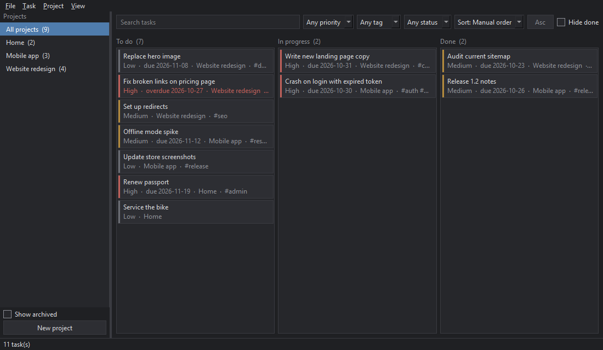

# Daybook

Desktop task and project manager. Tasks live in a local SQLite database; nothing is sent anywhere.



## Features

- Projects: create, edit, archive, delete (deleting removes the project's tasks).
- Tasks: title, description, priority, deadline, tags, status (To do / In progress / Done).
- Kanban board with drag-and-drop between and within columns, plus list and dashboard views.
- Search, sorting and filtering by project, priority, status, tag, and hide-completed.
- JSON and CSV import/export, database backup and restore.
- Themes (Dark, Graphite, Light) and rebindable keyboard shortcuts; settings persist between sessions.
- Import, export and backup run on a background thread; failures are shown as readable messages.

More screenshots: [list](docs/list.png), [dashboard](docs/dashboard.png).

## Requirements

- Python 3.10+
- PySide6 6.6+ (installed automatically)

## Install and run

```powershell
python -m venv .venv
.venv\Scripts\activate
pip install -e ".[dev]"
python -m daybook
```

Data (`daybook.db`, `settings.json`) is stored in `%APPDATA%\Daybook`. Override with
`python -m daybook --data-dir <folder>` or the `DAYBOOK_DATA_DIR` environment variable.

## Tests

```powershell
pytest
```

UI smoke tests run with Qt's offscreen platform (set automatically).

## Import / export notes

- JSON keeps everything, including empty and archived projects.
- CSV has one row per task (`project,title,description,priority,status,deadline,tags`; tags separated by `;`), so projects without tasks are not exported.
- Import adds to existing data and merges into projects with the same name. It does not de-duplicate tasks, so importing the same file twice creates duplicates. Invalid files are rejected as a whole with the offending row reported.
- Restoring a backup first saves the current data as `pre-restore-<timestamp>.db` next to the database.

## Build a Windows executable

```powershell
pip install -e ".[dev]"
pyinstaller --noconfirm --windowed --name Daybook --icon daybook\assets\icon.ico --add-data "daybook\assets;daybook\assets" run_daybook.py
```

The app is created in `dist\Daybook\Daybook.exe` (copy the whole folder). Use `--onefile` for a single exe (slower start-up).

## Screenshots

`python scripts/screenshots.py` regenerates `docs/*.png` from demo data.

## Known limitations

- Single user, no sync. Drag-and-drop ordering is global per status column; it is applied relative to the visible (filtered) cards.
- No undo; deletes ask for confirmation instead.

## Acknowledgment

AI tools helped with research, debugging, and development guidance.
